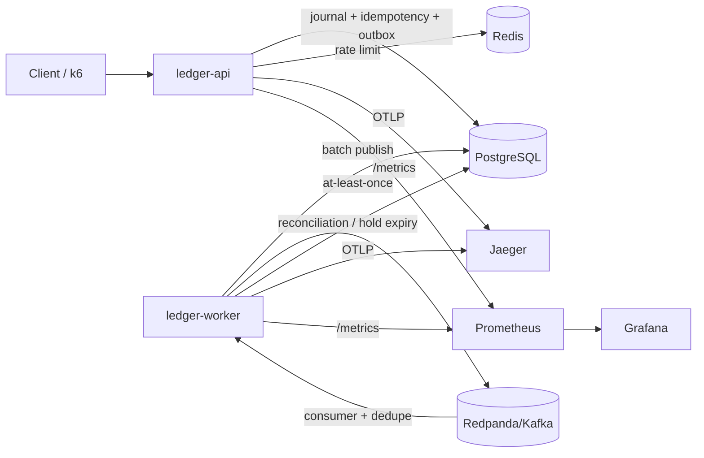

# Ledger — English summary

Idempotent double-entry payment ledger built with **Go, PostgreSQL, Redpanda
(Kafka API), Redis, Docker, Prometheus/Grafana, Jaeger and k6**.

The full documentation is in [README.md](README.md) (Russian). This page is a
short English overview for reviewers.

## What it demonstrates

- Immutable double-entry journal; every transaction balances per currency and is
  enforced by a deferred PostgreSQL constraint trigger.
- `Idempotency-Key` committed in the same transaction as the transfer. Concurrent
  duplicates wait on a unique index and replay the stored response.
- Transactional outbox → Kafka with at-least-once delivery and consumer-side
  deduplication (`processed_events`), i.e. exactly-once **effect**.
- Pessimistic row locks in deterministic UUID order, retries on deadlocks and
  serialization failures, `READ COMMITTED` for money paths.
- Holds with capture, release and expiry; same-currency transfers (no FX).
- Independent reconciliation that detects projection drift and repairs derived
  balances without touching the journal.
- API keys, rate limiting, OpenAPI, migrations, CLI, metrics, structured logs,
  OTLP traces, pprof, Docker Compose, Grafana dashboards and k6 scenarios.

## Architecture



## Quick start

```bash
make up        # full stack with observability
make seed      # 200 funded demo accounts
make apikey    # writes load/api-key.json
make demo      # transfer, exact duplicate, replay header, reconciliation
```

If ports 8080/9090 are busy, set `LEDGER_API_PORT`, `LEDGER_API_ADMIN_PORT`,
`LEDGER_API_URL`, `LEDGER_ADMIN_URL` in `.env`.

## Failure semantics

| Failure | Behaviour |
|---|---|
| Duplicate request | one effect, stored response replayed |
| Crash between commit and publish | outbox relay publishes later |
| Crash after publish before mark | duplicate event, consumer dedupes |
| Broker down | API keeps accepting, outbox grows, alert fires |
| Concurrent spend | row lock, exactly one succeeds, no negative balance |
| Deadlock | deterministic lock order plus retry |
| Process crash mid-transaction | rollback, no partial entries |

## Measured locally

16 vCPU / 31 GiB, Docker, single-node Redpanda, 200 accounts, `0.01 USD`
transfers:

| Scenario | Rate | p95 | p99 | Errors |
|---|---:|---:|---:|---:|
| transfers | 500 req/s | 2.60 ms | 4.61 ms | 0 |
| transfers | 1000 req/s | 3.38 ms | 10.57 ms | 0 |
| transfers | 2000 req/s | 5.31 ms | 19.06 ms | 0 |
| 3× duplicate key | 100 iter/s | 2.58 ms | 4.82 ms | 0 |
| reads | 1000 req/s | 0.67 ms | 0.84 ms | 0 |

At a 4000 req/s target the host saturated at ~3.3k req/s with p99 ~807 ms.
A hot-account experiment (5 accounts, 500 req/s) produced p99 ~173 ms, showing
the expected per-account lock serialisation. Full data:
[docs/benchmarks](docs/benchmarks/README.md).

## Documentation

- [Full README (Russian)](README.md)
- [5 ADRs](docs/adr)
- [OpenAPI 3.1](api/openapi.yaml)
- [Benchmarks and EXPLAIN plans](docs/benchmarks)
- [Security notes](SECURITY.md)

## Non-goals

No PCI DSS, KYC/AML, FX conversion, card networks, UI, Kubernetes or
multi-region deployment. This is a production-shaped portfolio project, not a
payment processor.
