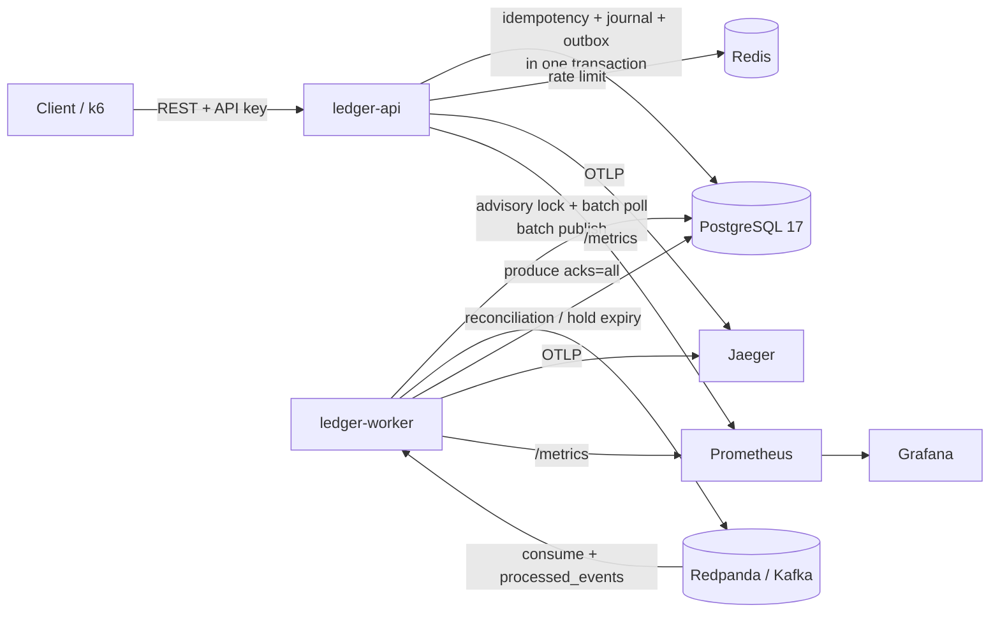

# Ledger

[](https://github.com/yugrinovd/ledger/actions/workflows/ci.yml)


[](https://github.com/yugrinovd/ledger/releases)

**An idempotent double-entry ledger with outbox, reconciliation and
observability.** Go + PostgreSQL + Redpanda (Kafka API) + Redis + Docker +
Prometheus/Grafana + Jaeger + k6.

[Full README in Russian](README.md) · [Changelog](CHANGELOG.md) ·
[ADRs](docs/adr) · [Benchmarks](docs/benchmarks) ·
[OpenAPI](api/openapi.yaml) · [Admin OpenAPI](api/admin.openapi.yaml)

**Part of [AI Ops Stack](https://github.com/yugrinovD/ai-ops-stack):**
[gogate](https://github.com/yugrinovD/gogate) ·
[lmlog](https://github.com/yugrinovD/lmlog) ·
[ops-console](https://github.com/yugrinovD/ops-console) ·
[ledger](https://github.com/yugrinovD/ledger) ·
[ai-ops-stack](https://github.com/yugrinovD/ai-ops-stack).

## What it is

I wanted to see what money accounting looks like when the interesting part is not
a CRUD screen but the invariants under concurrency. This is the result. It is not
a production PSP: no PCI DSS, KYC/AML, FX or card networks. Please don't put real
money in it.

What is inside:

- an immutable double-entry journal; balances are derived, not authoritative;
- `Idempotency-Key` committed in the same transaction as the transfer;
- a transactional outbox to Kafka/Redpanda with at-least-once delivery and
  consumer-side deduplication;
- holds with capture, release and expiry;
- reconciliation that checks invariants and repairs only derived projections;
- pessimistic locks in deterministic order, retries on deadlocks;
- OpenAPI, migrations, CLI, metrics, JSON logs, OTel traces, pprof;
- a k6 load suite with real p95/p99 and a post-run reconciliation check.

## Architecture



PostgreSQL is the only source of truth. Redis is used only for rate limiting and
fails open. Kafka is asynchronous: a dead broker does not block transfers, events
pile up in the outbox.

## Quick start

You need Docker Compose v2, `curl`, `jq` and free ports 8080/9090. Go 1.27 is
enough for local development without Docker.

```bash
make up        # Postgres, Redis, Redpanda, API, worker, Prometheus, Grafana, Jaeger
make seed      # 200 funded demo accounts
make apikey    # demo API key -> load/api-key.json
make demo      # transfer, duplicate, replay header, reconciliation
```

Important URLs:

| What | URL |
| --- | --- |
| API | <http://localhost:8080> |
| Admin API | <http://localhost:9090/admin/...> |
| readiness / metrics / pprof | `/readyz`, `/metrics`, `/debug/pprof/` on the admin port |
| Grafana | <http://localhost:3000> |
| Prometheus | <http://localhost:9095> |
| Jaeger | <http://localhost:16686> |
| Redpanda Console | <http://localhost:8082> |

If the ports are busy, set `LEDGER_API_PORT`, `LEDGER_API_ADMIN_PORT`,
`LEDGER_API_URL` and `LEDGER_ADMIN_URL` in `.env`.

Operational endpoints require `LEDGER_ADMIN_TOKEN`. It is not accepted on the
public API port and is not issued to tenant keys.

### Demos

```bash
./scripts/demo.sh          # transfer + replay + reconciliation
./scripts/demo-drift.sh    # corrupt a projection -> detect -> repair
./scripts/demo-outbox.sh   # stop Redpanda, transfer, restart, watch the drain
```

## API

The full spec is in [api/openapi.yaml](api/openapi.yaml). Errors use
`application/problem+json` with a machine-readable `code`.

```bash
API_KEY=$(jq -r .key load/api-key.json)
SOURCE=$(jq -r '.accounts[0].id' load/accounts.json)
DEST=$(jq -r '.accounts[1].id' load/accounts.json)
KEY=demo-$(date +%s)

curl -sS -X POST http://localhost:8080/v1/transfers \
  -H "Authorization: Bearer $API_KEY" \
  -H "Content-Type: application/json" \
  -H "Idempotency-Key: $KEY" \
  -d "{\"source_account_id\":\"$SOURCE\",\"destination_account_id\":\"$DEST\",\"amount\":\"10.00\",\"currency\":\"USD\",\"description\":\"demo\"}" | jq .
```

A repeat with the same key and body returns `201`, `Idempotent-Replayed: true`
and the same body.

| Method | Path | Purpose |
| --- | --- | --- |
| `POST` | `/v1/accounts` | create an account |
| `GET` | `/v1/accounts/{id}/balance` | balance / held / available |
| `GET` | `/v1/accounts/{id}/entries` | cursor-based statement |
| `POST` | `/v1/transfers` | transfer; `Idempotency-Key` is required |
| `POST` | `/v1/holds` | reserve funds |
| `POST` | `/v1/holds/{id}/capture` | capture a hold |
| `POST` | `/v1/holds/{id}/release` | release a hold |

Amounts are strings (`"10.50"`), never floats. An account has one currency;
cross-currency transfers are rejected.

The admin API covers reconciliation, freeze/unfreeze/close, API key revocation,
parked outbox and requeue: [api/admin.openapi.yaml](api/admin.openapi.yaml).

## How it works

**Double-entry.** `journal_entries` are immutable; `UPDATE/DELETE` are blocked by
a trigger. A deferred constraint checks debit = credit per currency inside the
transaction. `account_balances` is a read projection; reconciliation recomputes
it from the journal.

**Idempotency.** The key and the business effect commit together. A concurrent
duplicate waits on the unique index and reads the stored response. A crash before
commit rolls everything back; a crash after commit replays the saved response.
The same key with a different body returns `409 idempotency_key_reuse`. Scope is
`(owner_id, key)`, TTL 24 hours.

**Outbox.** The honest semantics are at-least-once delivery plus an idempotent
consumer, which gives an exactly-once effect. The relay publishes batches
(1000 events / 100 ms), marks them with one `UPDATE ... WHERE id = ANY($1)` and
holds leadership through a PostgreSQL advisory lock. Per-aggregate order is
enforced with a `NOT EXISTS` check for earlier unpublished events. Poison events
are parked after `LEDGER_OUTBOX_MAX_ATTEMPTS` and can be requeued from admin/CLI.

**Reconciliation.** An admin-only job under `pg_try_advisory_lock` checks the
journal/balance sum, active holds, empty or unbalanced transactions, transfer and
capture links, and outbox backlog. Repair is off by default and touches only
derived balances, never the journal.

## Concurrency

- `READ COMMITTED` + `SELECT ... FOR UPDATE` on balances.
- Accounts are locked in ascending UUID order, which kills the classic A→B /
  B→A deadlock.
- Holds are locked before accounts; the same order applies after that.
- Retries on `40001`, `40P01`, `55P03` with exponential backoff and jitter.
- Reconciliation reads `REPEATABLE READ READ ONLY`; repair takes an account lock.

The cost is real: one hot account serialises. At 500 req/s, 5 accounts gave p99
173 ms; 200 accounts gave 4.61 ms. Sharding accounts is the next scaling step, but
correctness does not depend on it.

## Load

Local runs: 16 vCPU, 31 GiB, Docker, single-node Redpanda, 200 accounts. Full
data: [docs/benchmarks](docs/benchmarks/README.md).

| Scenario | Rate | p95 | p99 | Errors |
| --- | ---: | ---: | ---: | ---: |
| steady transfer | 200 req/s | 2.50 ms | 3.59 ms | 0 |
| steady transfer | 500 req/s | 2.57 ms | 4.60 ms | 0 |
| steady transfer | 1000 req/s | 3.71 ms | 16.60 ms | 0 |
| steady transfer | 2000 req/s | 5.81 ms | 20.46 ms | 0 |
| duplicates, 3× one key | 100 iter/s | 2.43 ms | 3.35 ms | 0 |
| reads | 1000 req/s | 0.74 ms | 0.97 ms | 0 |

After the suite, `make reconcile` reports `discrepancy_count = 0`.

The outbox relay used to lag: after load it left 57,955 pending events. Batch
publishing and batch updates brought the backlog to 0. With strict per-aggregate
order there was a short ~973-event backlog at 1000 req/s, drained in under 10
seconds.

## Limitations

- Not a production PSP: no PCI DSS, KYC/AML, FX, card networks or a full identity
  provider.
- No UI, Kubernetes, multi-region or partial capture.
- One hot account limits per-account throughput; sharding is on the roadmap.
- Outbox and journal are not partitioned yet. TTL jobs exist but are not a
  replacement for partitioning.
- Requeue does not restore order once later events for the same aggregate have
  been published. Consumers must stay idempotent and order-tolerant.

## Tests and CI

```bash
make test              # unit + race
make test-integration  # PostgreSQL + Redis
make cover
```

Covered: money without floats, concurrent `Idempotency-Key` duplicates, opposite
transfers without deadlock, hold lifecycle and expiry, forbidden journal
`UPDATE/DELETE`, reconciliation and repair, outbox retry/batching/order, TTL,
admin-only access, tenant isolation and HTTP e2e.

CI: gofmt, vet, race, integration on PostgreSQL 17, OpenAPI validation,
`golangci-lint`, `govulncheck`, docker build.

## Docs

- [ADR-001: immutable double-entry journal](docs/adr/0001-double-entry-journal.md)
- [ADR-002: idempotency keys in PostgreSQL](docs/adr/0002-idempotency-in-postgres.md)
- [ADR-003: transactional outbox](docs/adr/0003-transactional-outbox.md)
- [ADR-004: isolation and deterministic locks](docs/adr/0004-isolation-and-locking.md)
- [ADR-005: money representation](docs/adr/0005-money-representation.md)
- [Benchmarks and EXPLAIN plans](docs/benchmarks)
- [Security notes](SECURITY.md)

## License

MIT. See [LICENSE](LICENSE). This is a demo project; read
[SECURITY.md](SECURITY.md) before using it with real money.
