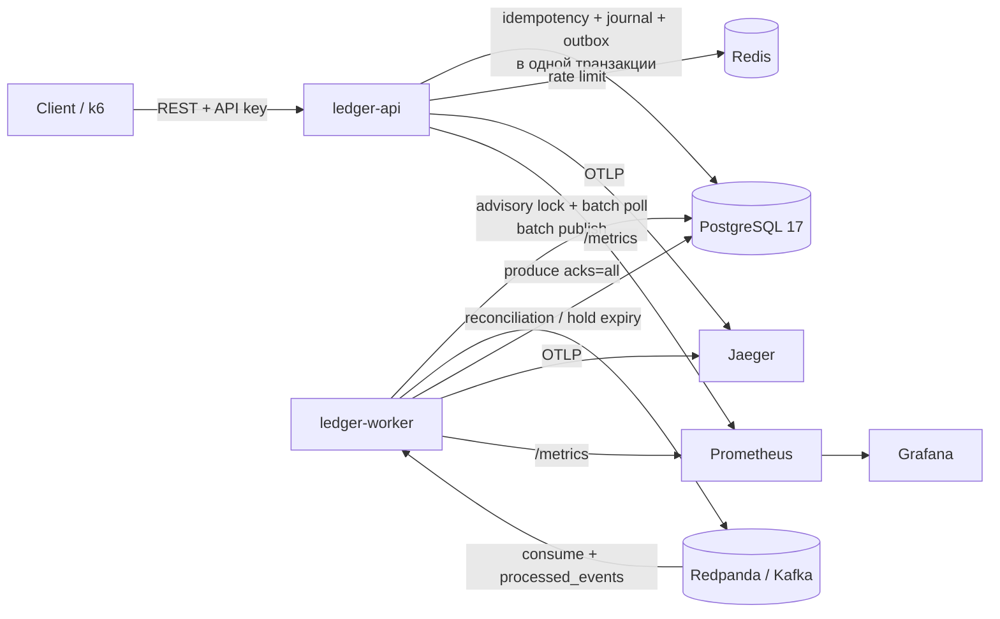
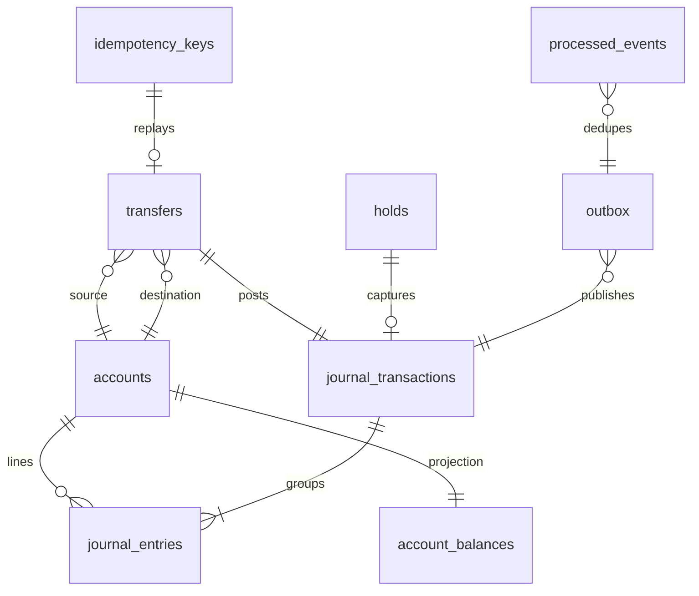
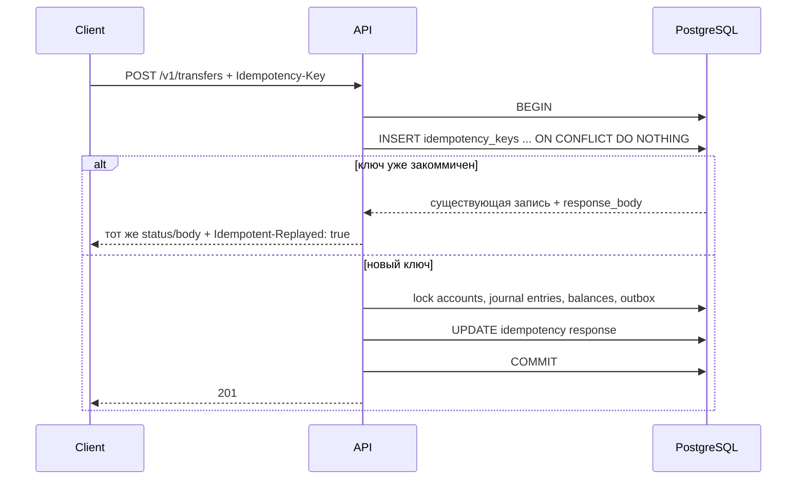
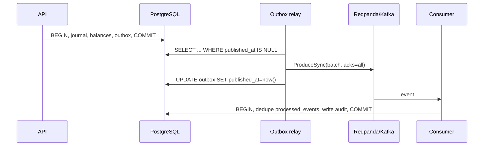

# Ledger

[](https://github.com/yugrinovd/ledger/actions/workflows/ci.yml)


**Идемпотентный double-entry ledger с outbox, reconciliation и наблюдаемостью.**
Go + PostgreSQL + Redpanda (Kafka API) + Redis + Docker + Prometheus/Grafana + Jaeger + k6.

[English summary](README.en.md) · [ADRs](docs/adr) · [Benchmarks](docs/benchmarks) · [OpenAPI](api/openapi.yaml) · [Admin OpenAPI](api/admin.openapi.yaml)

**Part of [AI Ops Stack](https://github.com/yugrinovD/ai-ops-stack):**
[gogate](https://github.com/yugrinovD/gogate) ·
[lmlog](https://github.com/yugrinovD/lmlog) ·
[ops-console](https://github.com/yugrinovD/ops-console) ·
[ledger](https://github.com/yugrinovD/ledger) ·
[ai-ops-stack](https://github.com/yugrinovD/ai-ops-stack).

---

## Что это

Сервис ведёт счета и переводы так, как это делают платёжные системы, а не
учебные CRUD-примеры:

- двойная запись: каждая транзакция сбалансирована, баланс — производная от
  неизменяемого журнала;
- `Idempotency-Key` + unique constraint + повтор запроса возвращает тот же ответ;
- transactional outbox → Kafka/Redpanda, at-least-once + дедупликация consumer’а;
- holds (резервирование средств) с capture/release/expiry;
- reconciliation, который независимо проверяет инварианты и умеет чинить только
  производные проекции;
- pessimistic locking, детерминированный порядок блокировок, retry на deadlock;
- OpenAPI, миграции, CLI, метрики, структурные логи, OTel-трейсы, pprof;
- k6-нагрузка с реальными p95/p99 и проверкой отсутствия расхождений после неё.

Это **не** production-PSP: здесь нет PCI DSS, KYC/AML, FX, карточных сетей и
полноценного identity-провайдера. Границы и roadmap описаны ниже.

## Архитектура



Ключевое решение: PostgreSQL — единственный источник истины. Redis используется
только для rate limiting (при его недоступности лимитер fail-open). Kafka
асинхронна по отношению к API: падение брокера не блокирует переводы, события
накапливаются в outbox.

## Быстрый старт

Нужны Docker Compose v2, `curl`, `jq` и свободные порты (по умолчанию 8080/9090).
Для локальной разработки без Docker — Go 1.27.

```bash
make up        # core + observability (Postgres, Redis, Redpanda, API, worker, Prometheus, Grafana, Jaeger)
make seed      # 200 демо-счетов + funding, пишет load/accounts.json
make apikey    # создаёт demo API key и пишет load/api-key.json
make demo      # перевод, повтор с тем же ключом, replay-заголовок, сверка
```

Адреса:

| Что | URL |
|---|---|
| API | http://localhost:8080 |
| Admin API (reconciliation, freeze/revoke) | http://localhost:9090/admin/... |
| readiness/metrics/pprof | http://localhost:9090/readyz, `/metrics`, `/debug/pprof/` |
| Grafana (admin/admin или анонимно) | http://localhost:3000 |
| Prometheus | http://localhost:9095 |
| Jaeger UI | http://localhost:16686 |
| Redpanda Console | http://localhost:8082 |

Если 8080/9090 заняты, создайте `.env`:

```dotenv
LEDGER_API_PORT=18080
LEDGER_API_ADMIN_PORT=19090
LEDGER_API_URL=http://localhost:18080
LEDGER_ADMIN_URL=http://localhost:19090
```

Compose и demo-скрипты подхватят эти значения.

Операционные endpoints требуют `LEDGER_ADMIN_TOKEN` (в dev по умолчанию
`dev-admin-token-change-me`). Он не принимается на публичном API-порту и не
выдаётся tenant-ключам.

### Демо-сценарии

```bash
./scripts/demo.sh          # идемпотентный перевод + replay + reconciliation
./scripts/demo-drift.sh    # порча projection -> сверка находит -> repair -> снова чисто
./scripts/demo-outbox.sh   # остановить Redpanda, сделать перевод, поднять брокер, увидеть drain
```

## API

Полная спецификация: [`api/openapi.yaml`](api/openapi.yaml). Ошибки —
`application/problem+json` с машинным `code`.

```bash
API_KEY=$(jq -r .key load/api-key.json)
SOURCE=$(jq -r '.accounts[0].id' load/accounts.json)
DEST=$(jq -r '.accounts[1].id' load/accounts.json)
KEY=demo-$(date +%s)

curl -sS -X POST http://localhost:8080/v1/transfers \
  -H "Authorization: Bearer $API_KEY" \
  -H "Content-Type: application/json" \
  -H "Idempotency-Key: $KEY" \
  -d "{\"source_account_id\":\"$SOURCE\",\"destination_account_id\":\"$DEST\",\"amount\":\"10.00\",\"currency\":\"USD\",\"description\":\"demo\"}" | jq .

# Тот же ключ и тело: 201 + Idempotent-Replayed: true, тот же id
curl -sS -D - -o /tmp/body.json -X POST http://localhost:8080/v1/transfers \
  -H "Authorization: Bearer $API_KEY" \
  -H "Content-Type: application/json" \
  -H "Idempotency-Key: $KEY" \
  -d "{\"source_account_id\":\"$SOURCE\",\"destination_account_id\":\"$DEST\",\"amount\":\"10.00\",\"currency\":\"USD\",\"description\":\"demo\"}"
cat /tmp/body.json | jq .

curl -sS http://localhost:8080/v1/accounts/$DEST/balance \
  -H "Authorization: Bearer $API_KEY" | jq .
```

Основные endpoints:

| Метод | Путь | Назначение |
|---|---|---|
| POST | `/v1/accounts` | создать счёт |
| GET | `/v1/accounts/{id}` | счёт |
| GET | `/v1/accounts/{id}/balance` | balance/held/available |
| GET | `/v1/accounts/{id}/entries` | выписка с курсором |
| POST | `/v1/transfers` | перевод (Idempotency-Key обязателен) |
| GET | `/v1/transfers/{id}` | перевод |
| POST | `/v1/holds` | резерв |
| POST | `/v1/holds/{id}/capture` | списать резерв получателю |
| POST | `/v1/holds/{id}/release` | освободить резерв |
Суммы передаются строками (`"10.50"`), никогда не float. Валюта счёта
фиксирована; перевод между разными валютами отклоняется (FX вне scope).

### Admin API

Reconciliation затрагивает весь ledger, поэтому вынесен с публичного API на
admin-порт и защищён отдельным токеном. Спецификация: [`api/admin.openapi.yaml`](api/admin.openapi.yaml).

| Метод | Путь | Назначение |
|---|---|---|
| GET | `/admin/reconciliation/runs` | история сверок |
| GET | `/admin/reconciliation/runs/{id}` | сверка + расхождения |
| POST | `/admin/accounts/{id}/freeze` | заморозить счёт |
| POST | `/admin/accounts/{id}/unfreeze` | разморозить счёт |
| POST | `/admin/accounts/{id}/close` | закрыть счёт с нулевым балансом |
| POST | `/admin/api-keys/{id}/revoke` | отозвать API key |
| GET | `/admin/outbox/parked` | события, запаркованные после исчерпания retry |
| POST | `/admin/outbox/{id}/requeue` | вернуть запаркованное событие в очередь |

```bash
curl -sS http://localhost:9090/admin/reconciliation/runs \
  -H "Authorization: Bearer ${LEDGER_ADMIN_TOKEN:-dev-admin-token-change-me}" | jq .

docker compose --profile tools run --rm ledgerctl apikey-revoke --id <key-id>
docker compose --profile tools run --rm ledgerctl account freeze --account <account-id>
docker compose --profile tools run --rm ledgerctl outbox ls-parked
docker compose --profile tools run --rm ledgerctl outbox requeue --id <outbox-id>
```

## Модель данных и double-entry



Почему double-entry:

- `journal_entries` неизменяемы; `UPDATE/DELETE` запрещены триггером.
- Deferred constraint trigger проверяет, что debit = credit **по каждой валюте**
  внутри транзакции; несбалансированная запись не коммитится.
- `account_balances` — быстрая проекция для чтения. Она обновляется в той же
  транзакции, но ей нельзя доверять в бухгалтерских решениях: reconciliation
  пересчитывает её из журнала.
- Баланс хранится в нормальном направлении счёта. Asset/expense — debit-normal,
  liability/equity/revenue — credit-normal. Перевод между счетами одного
  нормального направления уменьшает источник и увеличивает получателя.
  Например, между двумя liability-счетами: debit источник, credit получатель.

Пример: A переводит 10.50 B (оба — liability):

```
debit  A  10.50   (уменьшение обязательства перед A)
credit B  10.50   (увеличение обязательства перед B)
```

Сумма debit = сумме credit, инвариант закреплён в БД, а не только в коде.

## Идемпотентность



Почему это надёжно:

- key и бизнес-эффект коммитятся **вместе**; нет состояния «ключ есть, перевода нет»;
- конкурентный дубль блокируется на unique index, затем читает готовый ответ;
- падение до коммита откатывает всё, retry безопасен;
- падение после коммита — повтор возвращает сохранённый ответ;
- тот же ключ с другим телом → `409 idempotency_key_reuse`;
- доменные 4xx не кэшируются: после пополнения счёта тот же запрос можно повторить.

Скоуп ключа — `(owner_id, key)`, TTL 24 часа. TTL применяется атомарно:
`AcquireIdempotency` под блокировкой заменяет просроченную строку, поэтому
cleanup не может привести к ложному 404. Для transfer/hold остаётся постоянный
unique-ключ: очень поздний retry после TTL получит 409, а не создаст дубль.

## Outbox и exactly-once



Семантика сформулирована честно: **at-least-once delivery + idempotent
consumer = exactly-once effect**, а не «exactly-once delivery».

| Сбой | Что происходит |
|---|---|
| Дубль запроса | unique key + сохранённый ответ, эффект ровно один |
| Падение между commit и publish | outbox relay опубликует позже |
| Падение после publish до отметки | событие повторится, consumer дедуплицирует |
| Брокер недоступен | API продолжает работать, outbox растёт, срабатывает алерт |
| Consumer упал | offset не коммитится, событие переобработается |
| Poison message в consumer | 3 ретрая → DLQ, исходный offset коммитится |
| Poison event в outbox relay | после `LEDGER_OUTBOX_MAX_ATTEMPTS` событие паркуется, не блокирует более поздние события агрегата; admin/CLI может вернуть его через requeue |
| Частичный успех batch publish | часть событий может опубликоваться повторно; consumer дедуплицирует по `event_id` |
| Падение процесса в транзакции | rollback, частичных проводок нет |

Relay публикует батчи (по умолчанию 1000 событий / 100 мс) и отмечает их одним
`UPDATE ... WHERE id = ANY($1)`. Один активный relay выбирается через PostgreSQL
advisory lock на том же соединении, через которое идут все outbox-запросы:
если соединение умерло, lock освобождается, и старый лидер больше не публикует.
Строгий per-aggregate order обеспечивается запросом с `NOT EXISTS` более раннего
неопубликованного события; более поздние события агрегата ждут. Второй worker
находится в standby и подхватывает лидерство. Событие, исчерпавшее
`LEDGER_OUTBOX_MAX_ATTEMPTS`, получает `parked_at`: оно перестаёт блокировать
очередь агрегата, отражается в метрике `ledger_outbox_parked_events` и может быть
возвращено оператором через `/admin/outbox/{id}/requeue` или `ledgerctl outbox
requeue`. Requeue — операторский repair: если более поздние события того же
агрегата уже опубликованы, порядок не восстанавливается. Строгий per-aggregate
order гарантируется только для штатного пути без parking/requeue; consumers
обязаны быть идемпотентными и терпимыми к переупорядочиванию.

## Конкурентность, изоляция, deadlock

- Основной режим: `READ COMMITTED` + `SELECT ... FOR UPDATE` на балансы.
- Счета блокируются в возрастающем порядке UUID — это устраняет классический
  deadlock A→B / B→A.
- Holds блокируются до счетов; далее тот же порядок.
- Retry на `40001`, `40P01`, `55P03` с экспоненциальным backoff и jitter.
- Проверка available (`balance - held` с учётом `allow_negative`) выполняется под блокировкой.
- Reconciliation читает снапшот в `REPEATABLE READ READ ONLY`.
- Repair берёт account lock и пересчитывает проекцию из журнала в той же
  транзакции.

Цена решения: один горячий счёт сериализуется. Это видно в бенчмарках: 500 req/s
на 5 счетах даёт p99 173 мс, а на 200 счетах — 4.61 мс. Шардирование счетов —
следующий шаг масштабирования, корректность от него не зависит.

## Holds и мультивалютность

- hold резервирует available, увеличивая `held_minor`;
- capture создаёт сбалансированную journal-транзакцию и уменьшает `held_minor`;
- release и expiry-worker снимают резерв;
- просроченные hold’ы освобождаются фоновой джобой;
- `frozen` блокирует создание transfer/hold и capture уже созданного hold;
  release/expiry на frozen счёте разрешены, потому что только уменьшают `held`;
- счёт имеет одну валюту, перевод/холд требуют совпадения валют;
- source-счёт обязан принадлежать владельцу API key; destination — open-loop
  payee и может принадлежать другому tenant (см. ADR-006);
- мультивалютность = несколько валют в одном ledger, без FX. FX (rate snapshot,
  FX-position accounts, 4 проводки) — отдельный ADR/roadmap.

## Reconciliation

Reconciliation — операционная функция администратора: публичного API для неё
нет, только admin-порт с `LEDGER_ADMIN_TOKEN` и CLI. Джоба работает под
`pg_try_advisory_lock`:

1. `sum(journal_entries)` = `account_balances.balance_minor`;
2. `sum(active holds)` = `held_minor`;
3. каждая journal-транзакция сбалансирована;
4. нет journal-транзакций без проводок;
5. у каждого transfer/captured hold ровно две проводки и корректная связка
   `captured_transaction_id`;
6. outbox backlog и возраст старейшего события;
7. stretch: импорт внешней выписки.

Результаты пишутся в `reconciliation_runs` / `reconciliation_discrepancies`,
метрика `ledger_reconciliation_discrepancies{kind}`. Repair по умолчанию
выключен, меняет только производные балансы и никогда не трогает журнал.

```bash
make reconcile
docker compose --profile tools run --rm ledgerctl reconcile --repair
./scripts/demo-drift.sh
```

## Наблюдаемость

- **Метрики**: HTTP RED, transfers by status, idempotency replays, outbox
  pending/lag/failures/parked, consumer events, tx retries, holds expired,
  reconciliation discrepancies, retention deletes, estimated table rows,
  Go runtime/process.
- **Трейсы**: OTel → Jaeger. `traceparent` кладётся в headers outbox-события,
  поэтому один трейс покрывает `HTTP → usecase → outbox → Kafka → consumer`.
- **Логи**: JSON `slog`, `request_id`, `trace_id`, `owner_id`, без секретов и PII.
- **pprof**: admin-порт, включается `LEDGER_PROFILING=true` (по умолчанию выключен; `LEDGER_PROFILING=true make up`).
- **Алерты**: outbox backlog/lag/parked, 5xx > 1%, p99 > 500 мс,
  discrepancy > 0, высокий retry rate.
- **Retention**: published outbox — 7 дней, processed/audit/reconciliation —
  30 дней; настройки через `LEDGER_*_RETENTION`. Это не заменяет
  партиционирование больших журналов.

Проверка:

```bash
curl -sS http://localhost:9090/metrics | grep ledger_
open http://localhost:3000/d/ledger-overview
open http://localhost:16686
go tool pprof http://localhost:9090/debug/pprof/profile?seconds=30
```

## Нагрузка

Реальные локальные прогоны (16 vCPU, 31 GiB, Docker, single-node Redpanda,
200 демо-счетов). Полные данные и команды: [`docs/benchmarks`](docs/benchmarks/README.md).

| Сценарий | Rate | p95 | p99 | Ошибки |
|---|---:|---:|---:|---:|
| steady transfer | 200 req/s | 2.50 ms | 3.59 ms | 0 |
| steady transfer | 500 req/s | 2.57 ms | 4.60 ms | 0 |
| steady transfer | 1000 req/s | 3.71 ms | 16.60 ms | 0 |
| steady transfer | 2000 req/s | 5.81 ms | 20.46 ms | 0 |
| duplicates (3× один ключ) | 100 iter/s | 2.43 ms | 3.35 ms | 0 |
| reads | 1000 req/s | 0.74 ms | 0.97 ms | 0 |
| saturation target | 4000 req/s | 737 ms | 818 ms | 0, но rate не достигнут |

После серии прогонов `make reconcile` даёт `discrepancy_count = 0`.

Два честных вывода:

- горячие счёты — это предел per-account throughput; 5 счетов при 500 req/s
  дают p99 173 мс, 200 счетов — 4.61 мс;
- outbox relay изначально отставал (57 955 pending после серии нагрузок);
  батчирование публикации и batch-update снизили backlog до 0. После добавления
  строгого per-aggregate order при 1000 req/s наблюдался кратковременный backlog
  (~973 события), который дренировался менее чем за 10 секунд; после серии
  прогонов pending = 0.

## EXPLAIN и индексы

Основные индексы:

- `journal_entries(account_id, created_at DESC, id DESC)` — выписка;
- partial `outbox(available_at, id) WHERE published_at IS NULL` — polling relay;
- `idempotency_keys(owner_id, key)` PK — replay lookup;
- `transfers(owner_id, idempotency_key)` unique — защита от дублей;
- `holds(expires_at, id) WHERE status='active'` — expiry worker.

Примеры планов (полный файл — [`docs/benchmarks/explain.txt`](docs/benchmarks/explain.txt)):

```text
Limit (actual time=0.029..0.097 rows=21)
  -> Index Scan using journal_entries_account_idx
       Index Cond: (account_id = '...'::uuid)
       Execution Time: 0.146 ms

Limit (actual time=0.041..0.044 rows=0)
  -> Index Scan using outbox_pending_idx
       Index Cond: (available_at <= now())
       Execution Time: 0.108 ms

Index Scan using idempotency_keys_pkey
  Index Cond: ((owner_id = 'demo') AND (key = '...'))
  Execution Time: 0.099 ms
```

## Тесты

```bash
make test              # unit + race
make test-integration  # Postgres на 55432 + Redis на 55433
make cover
```

Покрыто:

- парсинг денег и валютных scale без float;
- конкурентные дубли одного `Idempotency-Key` (25 goroutines → 1 перевод);
- конкурентные списания (10×60 при балансе 100 → ровно одно успешное);
- встречные переводы A→B/B→A без deadlock;
- hold lifecycle, expiry и гонка capture/expire;
- несбалансированная journal-транзакция отклоняется БД;
- `UPDATE`/`DELETE` journal entries запрещены;
- reconciliation находит и чинит drift;
- outbox retry, публикация батчем, per-aggregate order и потеря лидерства;
- TTL/cleanup идемпотентности и retention;
- admin-only reconciliation, 401/403, freeze/revoke, tenant isolation;
- HTTP e2e: replay, 409 на другом теле, 422 insufficient funds, 401/403;
- allow_negative, currency mismatch, frozen/closed account.

CI: gofmt, vet, race-тесты, integration на PostgreSQL 17, OpenAPI validation,
`golangci-lint`, `govulncheck`, docker build.

## ADR

- [ADR-001: Immutable double-entry journal](docs/adr/0001-double-entry-journal.md)
- [ADR-002: Idempotency keys in PostgreSQL](docs/adr/0002-idempotency-in-postgres.md)
- [ADR-003: Transactional outbox vs 2PC](docs/adr/0003-transactional-outbox.md)
- [ADR-004: READ COMMITTED and deterministic locks](docs/adr/0004-isolation-and-locking.md)
- [ADR-005: Money representation and multi-currency](docs/adr/0005-money-representation.md)

## Структура

```text
cmd/api            HTTP API
cmd/worker         outbox relay, consumer, reconciliation, hold expiry
cmd/ledgerctl      migrate, seed, apikey, transfer, hold, reconcile, outbox, debug
internal/domain    деньги, модели, ошибки, инварианты
internal/usecase   переводы, счета, holds, reconciliation
internal/idempotency
internal/outbox
internal/db        common pgx Querier
internal/adapter   postgres, kafka, redis/ratelimit, httpapi
api/openapi.yaml
migrations         goose, embedded
deploy             compose, prometheus, grafana
load               k6 scenarios
docs               ADR, benchmarks, explain
```

## Конфигурация и безопасность

- `LEDGER_ENV=production` требует непустые не-default `LEDGER_AUTH_PEPPER` и
  `LEDGER_ADMIN_TOKEN` длиной не менее 32 символов; иначе процесс не стартует.
- Парсер env больше не подменяет неверные числа/длительности/bool на defaults:
  конфигурация падает с понятной ошибкой.
- `LEDGER_PREAUTH_RATE_LIMIT_RPM` ограничивает невалидные ключи по IP до auth;
  owner-лимит применяется после auth.
- `LEDGER_TRUSTED_PROXIES` — список CIDR. `X-Forwarded-For` учитывается только
  если непосредственный peer входит в trusted proxy network.
- `LEDGER_RECONCILIATION_STATEMENT_TIMEOUT` (5m) применяется через
  `SET LOCAL statement_timeout` только к reconciliation-транзакциям.
- `LEDGER_*_RETENTION` управляет TTL операционных таблиц; `processed_events`
  retention должен быть не меньше retention Kafka-топика.
- `LEDGER_ADMIN_TOKEN` не принимается на публичном API-порту; reconciliation и
  freeze/revoke доступны только на admin-порту.

## Non-goals и roadmap

Не входит в scope: FX/конвертация, карточные сети, PCI DSS, KYC/AML, UI,
Kubernetes, multi-region, полноценный identity-провайдер, partial capture.

Roadmap:

- партиционирование outbox и журнала, архивирование (TTL-джобы уже есть);
- шардирование по счетам / более умное распределение горячих счетов;
- partitioned relays для горизонтального масштабирования при сохранении порядка;
- отдельные DB-роли migrator/app и RLS для мультитенантности;
- partial capture и внешняя сверка с выпиской;
- Debezium CDC как альтернатива polling relay;
- read replica для выписок.

## Лицензия

MIT. См. [LICENSE](LICENSE). Проект демонстрационный; см. [SECURITY.md](SECURITY.md)
перед использованием в реальных деньгах.
