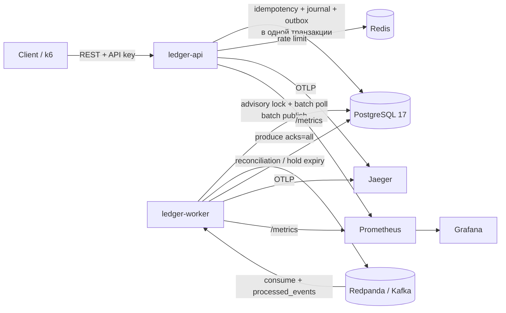
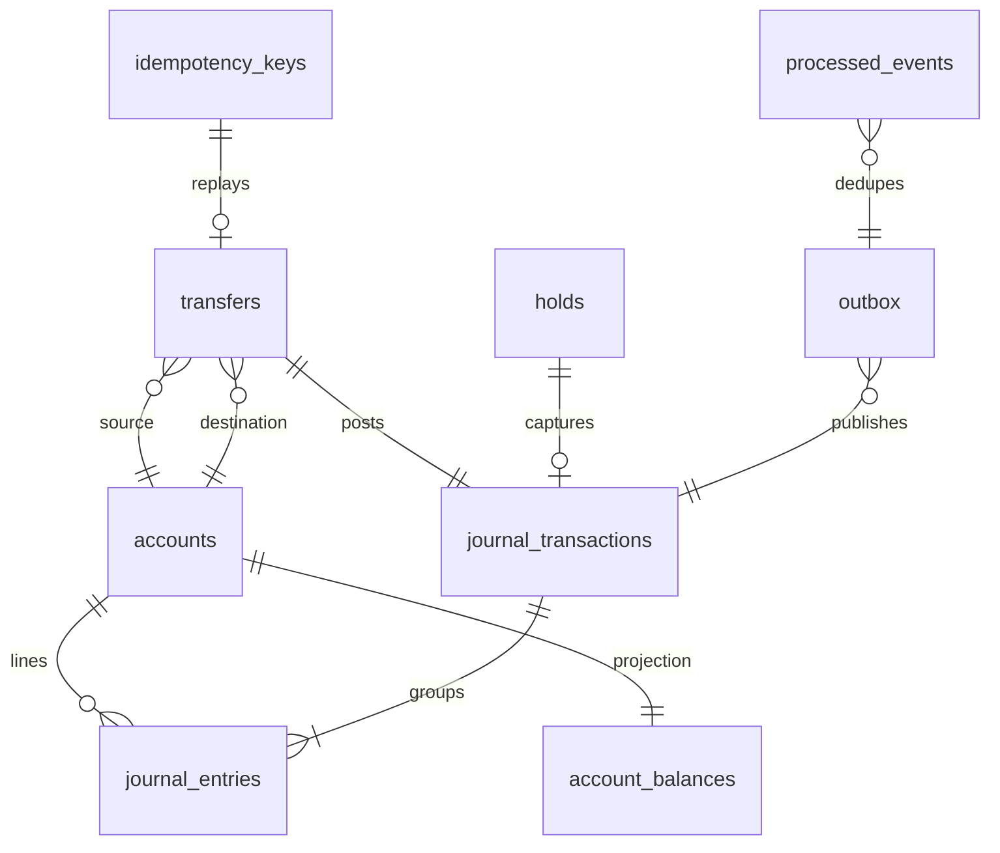

# Ledger

[](https://github.com/yugrinovd/ledger/actions/workflows/ci.yml)


[](https://github.com/yugrinovd/ledger/releases)

**Идемпотентный double-entry ledger с outbox, reconciliation и наблюдаемостью.**
Go + PostgreSQL + Redpanda (Kafka API) + Redis + Docker + Prometheus/Grafana +
Jaeger + k6.

[English summary](README.en.md) · [Changelog](CHANGELOG.md) · [ADRs](docs/adr) ·
[Benchmarks](docs/benchmarks) · [OpenAPI](api/openapi.yaml) ·
[Admin OpenAPI](api/admin.openapi.yaml)

**Part of [AI Ops Stack](https://github.com/yugrinovD/ai-ops-stack):**
[gogate](https://github.com/yugrinovD/gogate) ·
[lmlog](https://github.com/yugrinovD/lmlog) ·
[ops-console](https://github.com/yugrinovD/ops-console) ·
[ledger](https://github.com/yugrinovD/ledger) ·
[ai-ops-stack](https://github.com/yugrinovD/ai-ops-stack).

## Что это

Хотел разобраться, как выглядит учёт денег, когда вместо учебного CRUD нужно
держать инварианты под конкурентной нагрузкой. Получился отдельный сервис,
который не притворяется production-PSP: здесь нет PCI DSS, KYC/AML, FX и
карточных сетей.

Что внутри:

- двойная запись: каждая транзакция сбалансирована, баланс — производная от
  неизменяемого журнала;
- `Idempotency-Key` коммитится вместе с переводом, повтор возвращает тот же
  ответ;
- transactional outbox → Kafka/Redpanda, at-least-once + дедупликация
  consumer'а;
- holds с capture/release/expiry;
- reconciliation, который проверяет инварианты и чинит только производные
  проекции;
- pessimistic locking, детерминированный порядок блокировок, retry на deadlock;
- OpenAPI, миграции, CLI, метрики, JSON-логи, OTel-трейсы, pprof;
- k6-нагрузка с реальными p95/p99 и проверкой расхождений после прогона.

## Архитектура



PostgreSQL — единственный источник истины. Redis нужен только для rate limiting
и при недоступности fail-open. Kafka асинхронна: падение брокера не блокирует
переводы, события копятся в outbox.

## Быстрый старт

Нужны Docker Compose v2, `curl`, `jq` и свободные порты 8080/9090. Для локальной
разработки без Docker — Go 1.27.

```bash
make up        # Postgres, Redis, Redpanda, API, worker, Prometheus, Grafana, Jaeger
make seed      # 200 демо-счетов + funding
make apikey    # demo API key -> load/api-key.json
make demo      # перевод, повтор с тем же ключом, replay, сверка
```

Адреса:

| Что | URL |
| --- | --- |
| API | <http://localhost:8080> |
| Admin API | <http://localhost:9090/admin/...> |
| readiness / metrics / pprof | `/readyz`, `/metrics`, `/debug/pprof/` на admin-порту |
| Grafana | <http://localhost:3000> |
| Prometheus | <http://localhost:9095> |
| Jaeger | <http://localhost:16686> |
| Redpanda Console | <http://localhost:8082> |

Если порты заняты, задайте `LEDGER_API_PORT`, `LEDGER_API_ADMIN_PORT`,
`LEDGER_API_URL` и `LEDGER_ADMIN_URL` в `.env`.

Операционные endpoints требуют `LEDGER_ADMIN_TOKEN`. На публичном API-порту он
не принимается и tenant-ключам не выдаётся.

### Демо

```bash
./scripts/demo.sh          # перевод + replay + reconciliation
./scripts/demo-drift.sh    # порча projection -> сверка -> repair
./scripts/demo-outbox.sh   # остановить Redpanda, сделать перевод, поднять, drain
```

## API

Полная спецификация: [api/openapi.yaml](api/openapi.yaml). Ошибки —
`application/problem+json` с машинным `code`.

```bash
API_KEY=$(jq -r .key load/api-key.json)
SOURCE=$(jq -r '.accounts[0].id' load/accounts.json)
DEST=$(jq -r '.accounts[1].id' load/accounts.json)
KEY=demo-$(date +%s)

curl -sS -X POST http://localhost:8080/v1/transfers \
  -H "Authorization: Bearer $API_KEY" \
  -H "Content-Type: application/json" \
  -H "Idempotency-Key: $KEY" \
  -d "{\"source_account_id\":\"$SOURCE\",\"destination_account_id\":\"$DEST\",\"amount\":\"10.00\",\"currency\":\"USD\",\"description\":\"demo\"}" | jq .
```

Повтор с тем же ключом и телом вернёт `201`, `Idempotent-Replayed: true` и тот
же ответ.

| Метод | Путь | Назначение |
| --- | --- | --- |
| `POST` | `/v1/accounts` | создать счёт |
| `GET` | `/v1/accounts/{id}/balance` | balance / held / available |
| `GET` | `/v1/accounts/{id}/entries` | выписка с курсором |
| `POST` | `/v1/transfers` | перевод, `Idempotency-Key` обязателен |
| `POST` | `/v1/holds` | резерв |
| `POST` | `/v1/holds/{id}/capture` | списать резерв |
| `POST` | `/v1/holds/{id}/release` | освободить резерв |

Суммы передаются строками (`"10.50"`), никогда не float. У счёта одна валюта;
перевод между разными валютами отклоняется.

Admin API: reconciliation, freeze/unfreeze/close счёта, revoke API key,
parked outbox и requeue. Спецификация: [api/admin.openapi.yaml](api/admin.openapi.yaml).

## Как это устроено

### Double-entry

`journal_entries` неизменяемы, `UPDATE/DELETE` запрещены триггером. Deferred
constraint проверяет debit = credit по каждой валюте внутри транзакции.
`account_balances` — быстрая проекция для чтения; reconciliation пересчитывает
её из журнала.



### Идемпотентность

Ключ и бизнес-эффект коммитятся вместе. Конкурентный дубль блокируется на
unique index и читает готовый ответ. Падение до коммита откатывает всё, падение
после — повтор возвращает сохранённый ответ. Тот же ключ с другим телом даёт
`409 idempotency_key_reuse`. Скоуп ключа — `(owner_id, key)`, TTL 24 часа.

### Outbox

Семантика честная: at-least-once delivery + идемпотентный consumer =
exactly-once effect. Relay публикует батчи (1000 событий / 100 мс), отмечает их
одним `UPDATE ... WHERE id = ANY($1)` и держит лидерство через PostgreSQL
advisory lock. Строгий per-aggregate order — через `NOT EXISTS` более раннего
неопубликованного события. Poison events паркуются после
`LEDGER_OUTBOX_MAX_ATTEMPTS` и могут быть возвращены через admin/CLI.

### Reconciliation

Admin-only джоба под `pg_try_advisory_lock` проверяет:

- `sum(journal_entries)` = `account_balances`;
- `sum(active holds)` = `held_minor`;
- каждая journal-транзакция сбалансирована и не пустая;
- у transfer/captured hold корректная связка проводок;
- outbox backlog и возраст старейшего события.

Repair по умолчанию выключен и меняет только производные балансы, никогда не
журнал.

## Конкурентность

- `READ COMMITTED` + `SELECT ... FOR UPDATE` на балансы.
- Счета блокируются в возрастающем порядке UUID — классический deadlock A→B /
  B→A не возникает.
- Holds блокируются до счетов, дальше тот же порядок.
- Retry на `40001`, `40P01`, `55P03` с exponential backoff и jitter.
- Reconciliation читает `REPEATABLE READ READ ONLY`, repair берёт account lock.

Цена решения: один горячий счёт сериализуется. На 5 счетах при 500 req/s p99
был 173 мс, на 200 счетах — 4.61 мс. Шардирование счетов — следующий шаг, но
корректность от него не зависит.

## Нагрузка

Локальные прогоны: 16 vCPU, 31 GiB, Docker, single-node Redpanda, 200 счетов.
Полные данные: [docs/benchmarks](docs/benchmarks/README.md).

| Сценарий | Rate | p95 | p99 | Ошибки |
| --- | ---: | ---: | ---: | ---: |
| steady transfer | 200 req/s | 2.50 ms | 3.59 ms | 0 |
| steady transfer | 500 req/s | 2.57 ms | 4.60 ms | 0 |
| steady transfer | 1000 req/s | 3.71 ms | 16.60 ms | 0 |
| steady transfer | 2000 req/s | 5.81 ms | 20.46 ms | 0 |
| duplicates, 3× один ключ | 100 iter/s | 2.43 ms | 3.35 ms | 0 |
| reads | 1000 req/s | 0.74 ms | 0.97 ms | 0 |

После серии прогонов `make reconcile` даёт `discrepancy_count = 0`.

Outbox relay изначально отставал: после нагрузок оставалось 57 955 pending
событий. Батчирование публикации и batch-update снизили backlog до 0. После
добавления строгого порядка при 1000 req/s был кратковременный backlog ~973
события, который дренировался меньше чем за 10 секунд.

## Ограничения

- Не production-PSP: без PCI DSS, KYC/AML, FX, карточных сетей и полноценного
  identity-провайдера.
- Нет UI, Kubernetes, multi-region и partial capture.
- Один горячий счёт — предел per-account throughput; шардирование в roadmap.
- Outbox и журнал пока не партиционированы; TTL-джобы есть, но это не замена
  партиционированию.
- Requeue запаркованного события не восстанавливает порядок, если более поздние
  события агрегата уже опубликованы. Consumers должны быть идемпотентны.

## Тесты и CI

```bash
make test              # unit + race
make test-integration  # PostgreSQL + Redis
make cover
```

Покрыто: деньги без float, конкурентные дубли `Idempotency-Key`, встречные
переводы без deadlock, hold lifecycle и expiry, запрет `UPDATE/DELETE` журнала,
reconciliation и repair, outbox retry/batching/order, TTL, admin-only доступ,
tenant isolation, HTTP e2e.

CI: gofmt, vet, race, integration на PostgreSQL 17, OpenAPI validation,
`golangci-lint`, `govulncheck`, docker build.

## Документация

- [ADR-001: immutable double-entry journal](docs/adr/0001-double-entry-journal.md)
- [ADR-002: idempotency keys in PostgreSQL](docs/adr/0002-idempotency-in-postgres.md)
- [ADR-003: transactional outbox](docs/adr/0003-transactional-outbox.md)
- [ADR-004: isolation and deterministic locks](docs/adr/0004-isolation-and-locking.md)
- [ADR-005: money representation](docs/adr/0005-money-representation.md)
- [Benchmarks and EXPLAIN plans](docs/benchmarks)
- [Security notes](SECURITY.md)

## Лицензия

MIT. См. [LICENSE](LICENSE). Проект демонстрационный; перед использованием с
реальными деньгами прочитайте [SECURITY.md](SECURITY.md).
